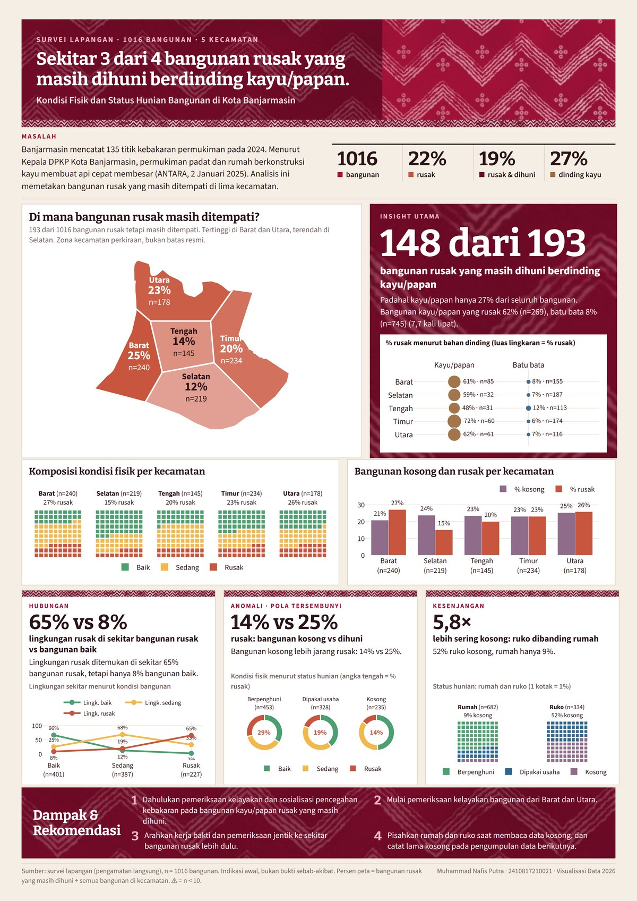

# Kondisi Fisik dan Status Hunian Bangunan di Kota Banjarmasin

Dashboard, peta 3D interaktif, insight, dan poster A3 tentang kondisi bangunan di lima kecamatan Kota Banjarmasin, dari survei lapangan.

- Dashboard: https://dashboard-bangunan-banjarmasin.streamlit.app/
- Peta 3D interaktif (rumah Banjar): https://muhammadnafisputra.github.io/visualisasi-data-bangunan/peta-3d/
Hasil dibaca sebagai indikasi awal, bukan bukti sebab-akibat.



Penulis: Muhammad Nafis Putra (2410817210021), mata kuliah Visualisasi Data, 2026.

## Problem
Banjarmasin mencatat 135 kebakaran permukiman pada 2024, dan rumah berkonstruksi kayu di permukiman padat
membuat api cepat membesar (ANTARA, 2 Januari 2025). Belum ada gambaran per kecamatan tentang bangunan rusak
yang masih ditempati.

## Dataset
`data/data_bangunan.xlsx` (sheet pertama). Seluruh data berasal dari survei lapangan berupa pengamatan
langsung terhadap 1.016 bangunan. Satu baris = satu bangunan.
Variabel:
Kecamatan, Kelurahan (tidak lengkap), Jenis Bangunan, Bahan Dinding, Kondisi Fisik, Status Hunian, Kondisi Lingkungan Sekitar.

## Tools
Python (pandas, NumPy), Plotly, Streamlit, MapLibre GL JS, Shapely, Playwright.

## Menjalankan
```
pip install -r requirements.txt
streamlit run app.py                 # dashboard
playwright install chromium          # sekali saja, untuk poster
python buat_poster.py                # poster/poster.pdf, poster.png, poster.html
python peta_3d/buat_peta3d.py        # peta 3D -> docs/peta-3d/index.html (GitHub Pages)
```

## Struktur
- `app.py` : tampilan dashboard (KPI, filter, insight, 7 grafik, rekomendasi), tema sasirangan.
- `insight.py` : perhitungan 5 insight (APA, MENGAPA, LALU APA, SEKARANG APA) dari data.
- `grafik.py` : 7 visualisasi, dipakai bersama oleh dashboard dan poster.
- `buat_poster.py` : poster A3 dari data dan insight yang sama.
- `data/kecamatan_perkiraan.geojson` : zona kecamatan PERKIRAAN (Voronoi), bukan batas resmi.
- `peta_3d/` : pembuat peta 3D interaktif (MapLibre GL): tiap kecamatan = 10 rumah Banjar, 1 rumah berwarna = 10% bangunan.
- `docs/peta-3d/index.html` : peta 3D yang diterbitkan lewat GitHub Pages; tautannya ada di bawah grafik peta dashboard.
- `poster/` : poster A3 hasil jadi (`poster.pdf`, `poster.png`); `poster.html` dibuat ulang oleh `buat_poster.py`.
- `docs/` : gambar pratinjau poster untuk README.
- `assets/` : potongan motif sasirangan, font Bitter dan Source Sans 3 (lisensi SIL OFL).

## Key Insights (n = 1.016)
1. 148 dari 193 bangunan rusak yang masih dihuni (77%) berdinding kayu/papan; kayu/papan hanya 27% dari bangunan.
2. 19% bangunan rusak tetapi masih dihuni; tertinggi di Barat (25%) dan Utara (23%), terendah di Selatan (12%).
3. Lingkungan rusak di sekitar 65% bangunan rusak, tetapi hanya 8% bangunan baik.
4. Bangunan kosong justru lebih jarang rusak daripada yang dihuni (14% vs 25%), karena 74% bangunan kosong adalah ruko
   yang sebagian besar masih baik; pada rumah saja, rumah kosong dan rumah dihuni hampir sama (33% vs 29%).
5. Ruko kosong 5,8 kali lebih sering daripada rumah (52% vs 9%).

## Recommendation
Dahulukan pemeriksaan kelayakan dan sosialisasi pencegahan kebakaran pada bangunan kayu/papan rusak yang masih
dihuni, mulai dari Barat dan Utara; arahkan kerja bakti dan pemeriksaan jentik ke sekitar bangunan rusak.

## Catatan
Kelompok dengan n < 10 diberi tanda ⚠. Selisih di bawah 5 poin persen ditulis "hampir sama".
Bangunan tidak dipilih secara acak. Data tidak mencatat usia bangunan, pendapatan, atau lama bangunan kosong.

## Lisensi
Kode memakai lisensi MIT (lihat `LICENSE`). Font memakai SIL OFL. Data dipakai untuk keperluan akademik.
